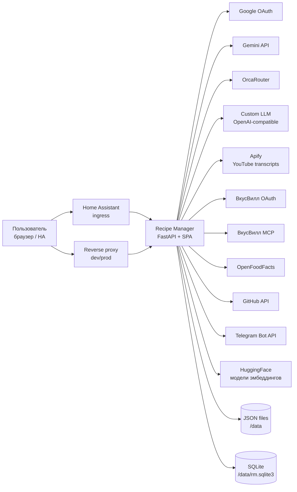
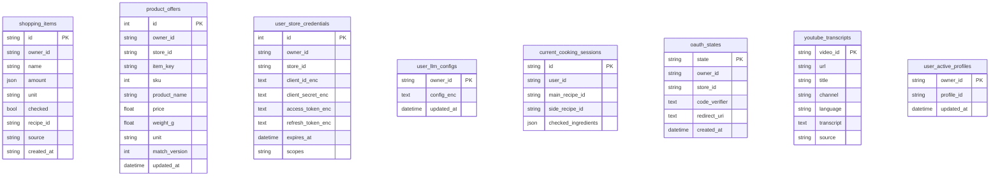
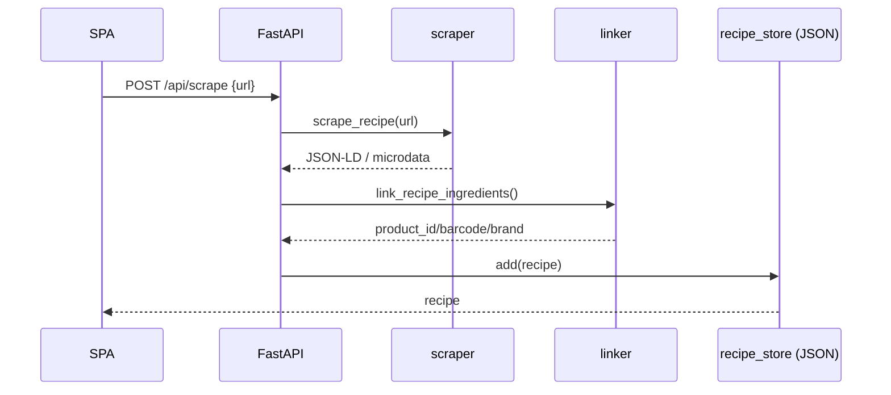
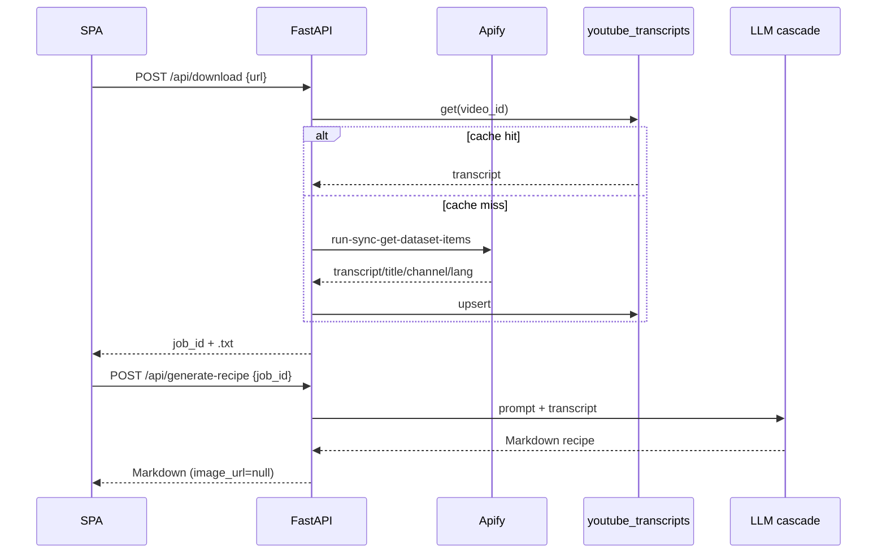
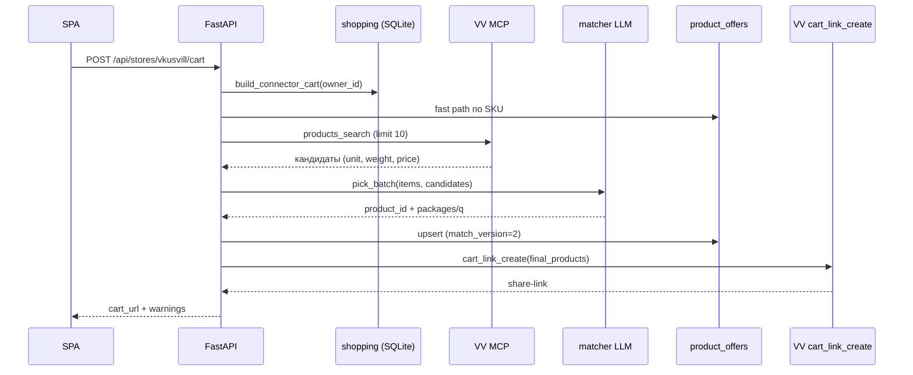

# Recipe Manager — архитектура проекта

**Версия:** 3.10.4  
**Дата:** 2026-11-02  
**Назначение документа:** передать архитектору целостную картину текущего
состояния: компоненты, данные, потоки, развёртывание, ограничения и риски.

---

## 1. Кратко

Recipe Manager (RM) — приложение для хранения рецептов, планирования питания,
списка покупок и сборки корзины в магазине. Работает в двух режимах:

- **HA add-on** — один контейнер внутри Home Assistant, доступ через ingress,
  все пользователи HA считаются одной семьёй (`owner_id = family`);
- **Standalone** — отдельный Docker-контейнер с Google OAuth, каждый
  пользователь получает свой `owner_id`, свои токены магазинов и LLM-ключи.

Технологии:

```text
Python 3.13 + FastAPI + Uvicorn
SQLAlchemy 2.0 + aiosqlite (SQLite, WAL)
Vanilla JS SPA без сборщика (window.RM)
JSON-файлы для рецептов, плана, продуктов, профилей
Docker / Home Assistant add-on (bashio)
```

Внешние сервисы: Google OAuth, Gemini, OrcaRouter, Custom OpenAI-совместимый
LLM, Apify, ВкусВилл OAuth + MCP, OpenFoodFacts, GitHub API, Telegram Bot API,
HuggingFace (модели эмбеддингов).

---

## 2. Контекст (C4, уровень 1)



---

## 3. Развёртывание

### 3.1 Площадки

| Среда | Домен / доступ | Контейнер | Порт | Данные | Auth |
|---|---|---|---|---|---|
| Dev | `<dev-host>` | `<dev-container>` | 8099 | `<dev-data>` | Google OAuth |
| Prod | `<prod-host>` | `<prod-container>` | 8199 → 8099 | `<prod-data>` | Google OAuth |
| HA add-on | HA ingress | add-on container | 8099 (ingress) | `/data` | HA ingress |

Перед приложением стоит reverse proxy (Caddy/nginx), который терминирует
TLS, добавляет security-заголовки и проксирует на локальные порты.
HA add-on не публикует порт: `ingress: true`, `ingress_port: 8099`,
`host_network: false`.

### 3.2 Standalone

```text
standalone/docker-compose.yml       → dev  (build context ..)
standalone/docker-compose.prod.yml  → prod
standalone/Dockerfile               → python:3.13-slim + torch + sentence-transformers
standalone/entrypoint.sh            → DEPLOY_MODE=standalone, AUTH_MODE=oauth, features=full
```

- `DATA_DIR=/data` (bind-mount), `DOWNLOAD_DIR=/data/downloads`.
- `hf_cache` — отдельный bind-mount для моделей HuggingFace.
- Healthcheck: `curl -f http://localhost:8099/api/health`.
- Dev дополнительно включает `TEST_MODE` (bypass только с loopback и
  `X-Test-Token`); prod — никогда.

### 3.3 HA add-on

```text
config.yaml      → опции аддона, ingress, версия, schema
run.sh           → bashio: читает /data/options.json, экспортирует env,
                   выбирает runtime_mode, ставит optional-зависимости,
                   запускает uvicorn
Dockerfile       → HA base image + venv + app
```

`runtime_mode`:

| Режим | Products | Matcher | Profiles | Generator |
|---|---|---|---|---|
| `minimal` | ✗ | ✗ | ✗ | ✗ |
| `standard` | ✓ | ✗ | ✗ | ✗ |
| `full` | ✓ | ✓ | ✓ | ✓ |

Ingress-путь пробрасывается через `X-Ingress-Path`; middleware выставляет
`request.scope["root_path"]`, чтобы FastAPI/SPA строили корректные ссылки.

> **OAuth в ingress.** Для провайдеров с публичным redirect URI (ВкусВилл)
> ingress-адрес плохо подходит: он содержит токен установки и может
> измениться при переустановке. Нужен стабильный внешний домен/прокси
> либо отдельный flow (device-code/relay). Подробнее — в вопросах ниже.

---

## 4. Компоненты

### 4.1 Backend: слои

```text
app/main.py            FastAPI app, lifespan, middleware, routers
app/config.py          все env/пути/feature flags
app/db.py              SQLite engine, create_all, миграция shopping JSON
app/routes/            HTTP API (21 модуль)
app/services/          бизнес-логика, LLM, импорт, нормализация, магазины
app/stores/            JSON/SQLite-репозитории и ORM-модели
app/integrations/      адаптеры внешних магазинов (ВкусВилл)
app/recipe_manager/    парсер Markdown-рецептов
app/static/            SPA: index.html, style.css, js/*, vendor/qrcode.js
app/recipe_template.md канонический шаблон рецепта
```

### 4.2 Роуты (группы)

| Префикс / модуль | Назначение |
|---|---|
| `/api/recipes` | CRUD рецептов, импорт/экспорт Markdown, форк, скрытие, active_time, аэрогриль |
| `/api/imports` (`/api/scrape`, `/api/recipes/import-*`) | импорт с сайтов, Markdown, batch |
| `/api/youtube` (`/api/download`, `/api/generate-recipe`) | YouTube → Apify → LLM |
| `/api/generator` | генерация рецептов, suggestions, jobs, статус провайдеров |
| `/api/profiles` | профили генерации и активный профиль (per-user) |
| `/api/matcher` | матчинг ингредиентов с продуктами, очередь подтверждений |
| `/api/products`, `/api/ingredients` | справочник продуктов |
| `/api/shopping` | список покупок, barcode lookup, from-recipe, export |
| `/api/stores` | ВкусВилл OAuth, проверка, сборка корзины |
| `/api/meal-plan` | план питания |
| `/api/cooking` | «Готовлю сейчас» |
| `/api/sharing` | публичные ссылки и форк |
| `/api/me`, `/api/auth` | пользователь, Google OAuth, LLM-ключи |
| `/api/settings` | глобальные настройки (в т.ч. Telegram) |
| `/api/sync` | GitHub pull/push |
| `/api/admin` | пользователи, веса, ZIP-бэкап |
| `/v1/embeddings` | standalone-эмбеддинги (SERVICE_TOKEN) |
| `/api/health`, `/share/{token}`, `/static/*` | служебное и публичная страница |

> Точный список endpoint’ов — в FastAPI OpenAPI (`/docs`) и в
> `app/routes/*.py`. В документе перечислены смысловые группы.

### 4.3 Frontend

Один `index.html`, один `style.css`, набор vanilla-JS модулей. Все модули
регистрируются в глобальном `window.RM`, без сборки и импортов.

| Модуль | Ответственность |
|---|---|
| `api.js` | fetch-обёртки, base-path для ingress |
| `app.js` | инициализация, auth-check, порядок setup |
| `tabs.js` | верхние вкладки и sub-tabs |
| `recipes.js`, `detail.js` | список и карточка рецепта |
| `editor.js` | редактор рецепта |
| `imports.js`, `youtube.js` | импорт с сайта/Markdown/YouTube |
| `generator.js`, `profiles.js` | генерация и профили |
| `shopping.js`, `stores.js` | покупки и магазины |
| `planner.js`, `plan-picker.js`, `recipe-picker.js` | план питания |
| `cooking.js` | «Готовлю сейчас» |
| `products.js`, `product-picker.js`, `matcher*.js` | продукты и матчинг |
| `cabinet.js`, `sync.js`, `help.js`, `walkthrough.js` | кабинет, синхронизация, помощь |
| `share.js` | копирование ссылки на публичной странице |
| `state.js`, `utils.js` | состояние и утилиты (в т.ч. markdown) |
| `vendor/qrcode.js` | локальная генерация QR (без CDN) |

Особенности:

- нет bundler’а и tree-shaking;
- cache-bust вручную: `?v=N` в `index.html`;
- состояние в памяти + серверные API, localStorage почти не используется;
- в ingress `api.js` строит BASE из `window.location.pathname`.

---

## 5. Данные

### 5.1 JSON-файлы (`DATA_DIR`, обычно `/data`)

| Файл | Содержимое | Владелец/скоуп |
|---|---|---|
| `recipes.json` | `{recipes: [...]}` — все рецепты | общий, фильтрация по `owner_id` |
| `ingredients.json` | справочник продуктов, алиасы, векторы, `installation_id` | общий |
| `gen_profiles.json` | профили генерации + legacy `active_id` | общий, активный профиль — per-user в SQLite |
| `meal_plan.json` | записи плана (`owner_id`, дата, приём) | per-user |
| `suggestions.json` | сгенерированные, но не принятые рецепты | per-user/global |
| `settings.json` | глобальные настройки (Telegram, лимиты, poll) | глобальный |
| `jobs.json` | фоновые LLM-задачи | глобальный |
| `rate_limits.json` | счётчики бесплатных генераций | per-user |
| `off_cache.json` | кэш OpenFoodFacts | глобальный |
| `embeddings_cache.json` | кэш векторов | глобальный |
| `shopping_list.json` | legacy-снимок списка покупок | мигрирован в SQLite |

`recipes.json` — **источник истины** для рецептов. Запись атомарная:
temp-файл + `replace`, под `asyncio.Lock`.

### 5.2 SQLite (`/data/rm.sqlite3`, WAL)

Источник истины для покупок, магазинов, LLM-ключей, сессий и кэшей.



Ключевые ограничения:

- `product_offers`: `UNIQUE(owner_id, store_id, item_key)`;
- `user_store_credentials`: `UNIQUE(owner_id, store_id)`;
- `current_cooking_sessions`: `UNIQUE(user_id)` — одна активная готовка;
- `user_active_profiles`: NULL = осознанный выбор «Без профиля».

Миграции: `db.init_db()` делает `create_all` + точечные `ALTER TABLE`
(например, `product_offers.match_version`). Отдельного migration framework нет.

### 5.3 Модель владения

| Режим | `owner_id` | Кто видит данные |
|---|---|---|
| Standalone/OAuth | Google `sub` | каждый свои рецепты/покупки/токены |
| HA add-on | `family` | все HA-пользователи — одна семья |
| Direct/legacy | `local`/`family` | один владелец |

Профили генерации — общие; выбранный профиль — per-user
(`user_active_profiles`). Продукты, настройки, Telegram — глобальные.

### 5.4 Схема рецепта

Стандарт: `app/recipe_template.md`, `SCHEMA_VERSION = 8`.
Верхний уровень:

```text
id, name, description, tags[], courses[], categories[], collections[],
cuisine, category, servings, servings_text,
prep_time, cook_time, time, total_time,
source_url, image_url, rating, is_favourite,
ingredients[{name, amount, unit, notes, optional, product_id, barcode, brand}],
instructions[string], notes, nutrition{...},
owner_id, owner_name, visibility, share_token,
schema_version, normalized_at, normalization_hash,
normalization_status, normalization_issues[], normalization_error
```

`normalization_status`: `ok` | `issues`. `normalization_issues` содержит
`severity: error|warning|info`, `code`, `message`, `ingredient_index` и т.п.

---

## 6. Ключевые потоки

### 6.1 Импорт с сайта / Markdown



- `recipe-scrapers` + BeautifulSoup + fallback JSON-LD.
- Markdown-импорт: `python-frontmatter` → `parse_markdown_recipe`.
- Batch-импорт: общий barcode-кэш, один OFF-запрос на barcode.
- После сохранения — нормализация (6.4).

### 6.2 YouTube → Apify → LLM



- `yt-dlp`/cookies/Deno удалены; единственный источник — Apify Actor
  (`automationnation/youtube-transcript-scraper`).
- Кэш `youtube_transcripts` экономит кредиты.
- Лимит: `$1.50 / 1000` транскриптов, free $5; при `used >= 90%`
  импорт скрывается и API отдаёт 503.
- Обложка из YouTube принудительно `null`; фото — вручную.

### 6.3 LLM-каскад

```text
1. Custom AI (user URL + key, OpenAI-compatible)
2. OrcaRouter (user key)
3. Gemini (user key)
4. Gemini (admin key, 5 бесплатных/день)
5. Hermes / external admin (опционально)
```

- per-user ключи — SQLite, Fernet.
- admin-провайдеры ограничены `rate_limits.json` (5/день).
- Gemini работает через фоновые interactions + polling; `resumer`
  восстанавливает незавершённые после рестарта.
- `services/file_logger.py` пишет JSONL в `/data/logs/llm_history.log`
  (до 10 000 символов ответа).

### 6.4 Нормализация рецептов

```text
Linter (детерминированный)
  → Normalizer (единицы, количества, дубли, optional)
  → Enricher (local fuzzy → product_id/barcode)
  → Worker (фон, один рецепт за итерацию)
```

- `schema_version=8`; `normalization_hash` защищает от затирания
  параллельных правок (`patch_if_unchanged`).
- Пороги: auto 0.95, suggest 0.80.
- `product_not_found` — info, не warning.
- Фоновый worker спит, пока пользователь активен (`activity.is_active`).

### 6.5 Покупки и ВкусВилл



- Список покупок — SQLite (`shopping_items`), per `owner_id`.
- Fast path: SKU из `product_offers`; иначе LLM-матчинг.
- Весовые товары (`unit=кг/л`, `weight=null`) получают `q` в кг/л,
  упакованные — `q` в упаковках.
- Для весовых ингредиентов матчер сначала рассматривает весовые товары,
  сравнивает `price_per_kg`; старые записи кэша (`match_version<2`)
  перепроверяются один раз.
- **Ограничение ВкусВилла:** MCP умеет только `vkusvill_cart_link_create`,
  т.е. создаёт **share-ссылку** (`?basket&share=...`), а не пишет в личную
  корзину. Пользователь нажимает «Добавить к себе».
- OAuth: `authorization_code` + PKCE S256, `state` в `oauth_states`
  (TTL 10 минут), токены per-user, Fernet.
- Доступные MCP tools (11): orders_history, shops, products_search,
  product_details, product_barcode, product_analogs, cart_link_create,
  products_discount, product_lp, discounts_personal, recipes.

### 6.6 «Готовлю сейчас»

- SQLite `current_cooking_sessions`: main/side recipe, checked ingredients.
- API `/api/cooking/current`, `/check`, `/send-to-plan`, `/send-to-shopping`.
- Ингредиенты объединяются по `name|unit`; таймеры извлекаются из шагов.
- Шаги рендерятся безопасным markdown (`**bold**`, `*italic*`, списки).

### 6.7 Публичные ссылки

- `POST /api/sharing/{recipe_id}/share` — только владелец/админ.
- Токен: 32 hex (128 бит), старые 12-символьные продолжают работать.
- `GET /share/{token}` — **отдельная серверная страница**, без SPA:
  whitelist полей, экранирование, CSP, `noindex`, `no-referrer`,
  `no-store`, `X-Frame-Options: DENY`.
- `GET /api/sharing/{token}` — sanitized DTO (без `owner_id`/`share_token`),
  rate-limit 60/мин на IP (in-memory).
- `POST /api/sharing/{token}/fork` — требует авторизации, копия создаётся
  текущему пользователю.
- Модалка в SPA: QR (локальная библиотека), ссылка, копирование.

### 6.8 Аутентификация

**Standalone (Google OAuth):**

```text
GET /api/auth/login → Google → /api/auth/callback
callback: allowlist email → users.json → cookie rm_session=<user_id>
```

- cookie: `HttpOnly`, `SameSite=Lax`, `Secure` при HTTPS, 7 дней.
- пользователи: `users.json` (`users` + `allowed_emails`), роли admin/user.
- LLM-ключи: `user_llm_configs` (Fernet), миграция из `users.json`.

**HA add-on:**

- ingress; приложение не логинит, доверяет HA.
- `get_current_user()` → `{"id": "family", "role": "admin"}`.
- `/api/me` в HA/direct также возвращает `role=admin`.
- Заголовки `X-Remote-User-*` используются только для отображения имени.

---

## 7. Конфигурация

### 7.1 Основные env-группы

| Группа | Переменные |
|---|---|
| Режим | `DEPLOY_MODE`, `AUTH_MODE`, `RUNTIME_MODE`, `ADDON_VERSION` |
| Пути | `DATA_DIR`, `DOWNLOAD_DIR` |
| Безопасность | `SECRET_KEY`, `TEST_MODE`, `TEST_TOKEN` |
| Google | `GOOGLE_CLIENT_ID`, `GOOGLE_CLIENT_SECRET`, `GOOGLE_REDIRECT_URI` |
| Gemini | `GEMINI_API_KEY`, `GEMINI_MODELS`, `GEMINI_PROXY` |
| OrcaRouter | `ORC_BASE_URL`, `ORC_MODELS`, `ORC_TIMEOUT` |
| YouTube/Apify | `APIFY_TOKEN`, `APIFY_ACTOR_ID`, `APIFY_STOP_RATIO`, `APIFY_QUOTA_LIMIT_USD`, `FEATURE_YOUTUBE_IMPORT` |
| Матчинг | `MATCHER_*`, `EMBEDDING_*`, `LOCAL_EMBEDDER_*` |
| OpenFoodFacts | `OFF_*` |
| GitHub | `GITHUB_REPO`, `GITHUB_TOKEN`, `GITHUB_BRANCH`, `GITHUB_PATH`, `GITHUB_INGREDIENTS_*` |
| Генерация | `GENERATOR_*` |
| Нормализация | `RECIPE_NORMALIZER_*`, `RECIPE_ENRICHER_ENABLED` |
| ВкусВилл | `VKUSVILL_CLIENT_ID`, `VKUSVILL_CLIENT_SECRET`, `VKUSVILL_REDIRECT_URI`, `VKUSVILL_SCOPES`, `VKUSVILL_MCP_URL`, `VKUSVILL_*` |
| Standalone embeddings | `STANDALONE_EMBEDDING_MODEL`, `SERVICE_TOKEN` |

### 7.2 HA add-on options

`config.yaml` дублирует ключевые настройки: Gemini, VKUSVILL, Apify,
OpenFoodFacts, matcher, generator, GitHub, нормализация, `runtime_mode`,
`youtube_import_enabled`. `run.sh` читает `/data/options.json` через `jq`
и экспортирует env.

### 7.3 Feature flags

```text
FEATURE_PRODUCTS
FEATURE_MATCHER
FEATURE_PROFILES
FEATURE_GENERATOR
FEATURE_YOUTUBE_IMPORT
```

В standalone `entrypoint.sh` принудительно включает products/matcher/
profiles/generator (full).

---

## 8. Безопасность

### 8.1 Что сделано

- OAuth PKCE + state на сервере, TTL 10 минут, привязка к `owner_id`.
- Токены магазинов и LLM-ключи — Fernet (ключ производный от `SECRET_KEY`,
  контексты `store-credentials` и `llm-configs`).
- `SECRET_KEY` не хранится в БД и не логируется.
- Публичная share-страница: CSP, noindex, no-referrer, whitelist полей,
  rate-limit, экранирование.
- Share API: создание/отзыв/форк требуют авторизации и владельца.
- Ingress: `X-Ingress-Path` → `root_path`; прямой доступ к HA-контейнеру
  не опубликован.
- `TEST_MODE` — только loopback + токен, только dev.

### 8.2 Риски и долги (важно для архитектора)

| Риск | Уровень | Комментарий / что делать |
|---|---|---|
| `rm_session` = **сырой user id** (неподписанный) | **высокий** | при утечке cookie можно выдать себя за пользователя. Нужен случайный session id → map или подписанный токен + ротация. |
| `GET/POST /api/settings` **без авторизации** | **высокий** | отдаёт `telegram_bot_token` и позволяет менять глобальные настройки. На публичном standalone доступно любому. Нужен admin-check. |
| `SECRET_KEY` общий для dev и prod | средний | компромисс одного окружения раскрывает шифрование другого. Развести ключи; при ротации перешифровать `*_enc`. |
| CORS `allow_origins=["*"]` | средний | при `credentials=false`; но публичные GET (settings) читаются с любого origin. |
| HA-режим доверяет `X-Remote-User-*` | средний | безопасно только за HA ingress; нельзя публиковать порт напрямую. |
| `/api/debug/static` | низкий | раскрывает пути/список файлов; убрать/закрыть admin. |
| Share rate-limit in-memory | низкий | не работает между репликами; для одного контейнера ок. |
| Legacy 12-символьные share-токены | низкий | 48 бит; новые 32 hex; старые можно мигрировать. |
| LLM-логи содержат пользовательский контент | низкий/средний | `/data/logs/llm_history.log`; ротация/очистка. |
| Apify — третья сторона | средний | транскрипты уходят в Apify; учесть в политике. |
| VV MCP не пишет в личную корзину | продуктовый | только share-ссылка; нужен API/скоуп от ВК. |

---

## 9. Эксплуатация

### 9.1 Health / логи

```text
GET /api/health → {status, models, api_key, recipes, meal_plan_entries}
docker logs <container>
/data/logs/llm_history.log  (JSONL)
```

Приложение логирует через `print()`/`logging` в stdout; Docker собирает
json-file (ротация 10 MB × 3 у коннектора; у RM — стандартный драйвер).

### 9.2 Бэкапы

- `GET /api/admin/backup.zip` — ZIP JSON-файлов из `DATA_DIR`.
- GitHub sync (`/api/sync/push`) — атомарный коммит `recipes.json` +
  `ingredients.json` через Git Data API.
- Операционные бэкапы: tar каталога данных на хосте.
- `services/backup.py` (rolling JSON backup) **не подключён** к lifespan
  и импортирует отсутствующие в `config.py` константы — считать legacy.

### 9.3 Релиз

1. Изменить код/`config.yaml version`/`CHANGELOG.md`.
2. `py_compile` / `node --check`, cache-bust `?v=N` при изменениях JS/CSS/HTML.
3. Собрать dev, проверить; затем prod.
4. `git push` → GitHub; HA add-on обновляется из репозитория.
5. Версия аддона — `config.yaml`; standalone версия отображается из
   `ADDON_VERSION` (в standalone может быть `unknown`).

---

## 10. Ограничения и технический долг

1. **Рецепты, план, продукты, профили — JSON + in-memory.** Один процесс,
   `asyncio.Lock`; горизонтальное масштабирование невозможно без переезда
   в SQLite/БД.
2. **Смешанное хранение:** часть данных в JSON, часть в SQLite; миграции
   ad-hoc, без Alembic.
3. **`services/backup.py` не работает** (см. 9.2).
4. **Документация отстаёт:** `docs/RECIPE_NORMALIZATION.md` говорит
   `schema_version=7`, код — 8.
5. **`config.py` содержит устаревший комментарий `# --- yt-dlp`** и
   `_env_bool`; сам yt-dlp удалён.
6. **Дефолты VKUSVILL_SCOPES расходятся:** `config.py` включает
   `recommendations.personalized`, `config.yaml` — нет; фактические scopes
   задаются env.
7. **HA = один `family`-владелец:** нет изоляции между HA-пользователями.
8. **Нет CSRF-токенов**; защита — `SameSite=Lax` + HttpOnly. Для
   state-changing API стоит добавить CSRF.
9. **Публичная share-страница** — серверный HTML; стили инлайновые,
   отдельного шаблонизатора нет.
10. **ВкусВилл:** MCP отдаёт только share-корзину; персональная корзина
    недоступна.
11. **YouTube:** зависимость от Apify, стоимость и лимиты; кэш помогает,
    но при исчерпании $5 импорт отключается.
12. **LLM:** Gemini-фоновые interactions могут зависать/возвращать
    `incomplete`; есть fallback-каскад и resumer, но latency высокая.

---

## 11. Вопросы архитектору

1. Доводим ли JSON-хранилища (рецепты, план, продукты) до SQLite и
   добавляем Alembic? Это ключ к multi-instance и нормальным миграциям.
2. Оставляем ли HA-режим «одна семья = один владелец» или нужна
   per-user изоляция внутри HA?
3. Как закрываем `rm_session` (сырой id) и `/api/settings` — до или после
   следующего релиза?
4. Стратегия OAuth-callback для HA ingress: постоянный прокси-домен,
   relay или device-code flow от ВК?
5. Нужен ли публичный share-страницам срок жизни/one-time/пароль?
6. Бюджет на Apify/Gemini и политика хранения транскриптов/LLM-логов.
7. Разводим ли `SECRET_KEY` по окружениям и как проводим ротацию
   (перешифровка `user_llm_configs`, `user_store_credentials`)?

---

## 12. Карта файлов

```text
app/
  main.py                  FastAPI, lifespan, middleware
  config.py                env, пути, feature flags
  db.py                    SQLite, create_all, миграция shopping
  routes/
    recipes.py             CRUD, импорт/экспорт, active_time, аэрогриль
    imports.py             scrape / markdown / batch
    youtube.py             Apify → LLM
    generator.py           генерация, suggestions, jobs
    profiles.py            профили и активный профиль
    matcher.py             матчинг и очередь
    products.py            продукты
    ingredients.py         ингредиенты/справочник
    shopping.py            покупки
    stores.py              ВкусВилл OAuth + корзина
    meal_plan.py           план
    cooking.py             «Готовлю сейчас»
    sharing.py             публичные ссылки
    me.py, auth.py         пользователь, Google OAuth, LLM-ключи
    settings.py            глобальные настройки
    sync.py                GitHub
    admin.py, backup.py    админ, ZIP-бэкап
    misc.py                статика, health, /share
    embeddings.py          /v1/embeddings
  services/
    llm_cascade.py         Custom → Orca → Gemini → admin
    gemini.py              Gemini interactions + polling
    custom_llm.py          OpenAI-compatible
    orcarouter.py          OrcaRouter
    apify_transcript.py    Apify + кэш + лимиты
    matcher/               exact → fuzzy → embeddings → generative
    generator/             prompt, providers, orchestration
    recipe_normalizer.py   детерминированная нормализация
    recipe_linter.py       проверки
    recipe_enricher.py     product links
    recipe_normalizer_worker.py
    cooking.py             merge/session/plan/shopping
    share_view.py          серверная share-страница
    secret_store.py        Fernet
    github_sync.py         атомарный push/pull
    telegram_service.py    уведомления
    rate_limiter.py        5 бесплатных генераций
    file_logger.py         JSONL LLM-логов
  stores/
    recipes.py             JSON recipes
    ingredients.py         JSON products
    gen_profiles.py        JSON profiles
    meal_plan.py           JSON plan
    suggestions.py         JSON suggestions
    jobs.py                JSON jobs
    shopping.py            SQLite shopping
    product_offers.py      SQLite SKU cache
    store_credentials.py   SQLite OAuth tokens (Fernet)
    llm_configs.py         SQLite LLM keys (Fernet)
    cooking_sessions.py    SQLite cooking session
    youtube_transcripts.py SQLite transcript cache
    user_active_profiles.py SQLite per-user profile
    db_models.py           ORM models
  integrations/stores/vkusvill/
    oauth.py               OAuth + PKCE + refresh/revoke
    mcp_client.py          JSON-RPC MCP
    client.py              search/details/barcode/cart
    matcher.py             LLM-подбор товаров
    cart.py                fast/slow path, weight logic
    models.py              Pydantic-модели
  recipe_manager/importer.py  Markdown → recipe
  static/                  SPA
docs/
  ADR-001-modular-monolith-stores.md
  ADR-002-youtube-apify.md
  RECIPE_NORMALIZATION.md
  COOKING_NOW.md
  STORES_TESTING.md
  YOUTUBE_IMPORT_ISSUE.md
  ARCHITECTURE.md          этот документ
```

---

## 13. Текущее состояние (снимок)

- Версия: **3.10.4**.
- Dev: `<dev-host>` → `<dev-container>:8099`.
- Prod: `<prod-host>` → `<prod-container>:8199`.
- HA add-on: ingress, `/data`, runtime_mode `full`.
- Количество рецептов/продуктов/пользователей зависит от инсталляции
  и в документе не фиксируется.
- Репозиторий: `<org>/<repo>`, ветка `main`.
```
